# Auditoría Técnica y Roadmap de Implementación (Audit123 - v2 Hardened)

Este documento detalla el diagnóstico arquitectónico de los problemas reportados y el plan de ejecución ajustado con las observaciones técnicas y mitigaciones de riesgos para **OxideTube** (`mitub`).

---

## 1. Diagnóstico de Problemas Identificados

### A. Buscador (Search Bar UX)
1. **Re-estiramiento brusco al hacer clic**:
   - *Causa*: En `src/main.rs`, al detectar un clic cuando `search_hovered == true`, se reinicia la animación con `search_focus_anim = Some((true, Instant::now()))`. En `current_search_bar_width()`, la función asume rígidamente una interpolación de inicio fijo `(145.0 -> 300.0)`. Si la barra ya medía `300px` por el hover, al hacer clic salta instantáneamente a `145px` y se re-anima a `300px`.
2. **Placeholder invisible durante el hover**:
   - *Causa*: En `src/ui/mod.rs` (`view_header_bar`), el texto `"Buscar o pegar enlace..."` está condicionado estrictamente a `is_search_focused || !search_query.is_empty()`. Durante el hover, como no hay foco activo, permanece congelado en `"Buscar..."`.
3. **Comportamiento tosco ("Clunky") al pasar el cursor rápido**:
   - *Causa*: Al salir del hover a mitad de animación (ej. ancho en `210px`), si la animación tuviera duración fija se movería a velocidad artificial inconsistente. Además, el botón de la lupa (`search_btn`) está fuera del `mouse_area` del input; mover el cursor hacia la lupa provoca que la barra se encoja inmediatamente.

---

### B. Detección de Videos Descargados y "Doble Buffer"
1. **Doble buffer y stream desincronizado al descargar en vivo**:
   - *Causa*: Cuando la descarga finaliza en segundo plano (`Message::FullBufferComplete`), la app guarda el archivo en caché pero **mantiene a `libmpv` reproduciendo el enlace HTTP de YouTube**. `libmpv` continúa descargando por su cuenta en su buffer de red de 24 MB, consumiendo ancho de banda redundante y RAM.
2. **Barra de buffer incompleta y mensaje `(+Ns buffer)` erróneo**:
   - *Causa*: `buffered_ratio` en `ProgressBarProgram` y el texto `(+Ns buffer)` leen únicamente `state.buffered_pos_secs` reportado por el demuxer en memoria de `mpv`. Si el video ya está descargado al 100% en disco, la barra de progreso nunca se muestra blanca hasta el final y continúa informando de segundos de buffer volátil.
3. **Pérdida de estado de videos ya descargados en disco**:
   - *Causa*: Al iniciar la app o abrir un video que ya se había descargado con anterioridad, `buffer_downloads` inicia vacío (`HashMap::new()`). `OpenVideo` no consulta si existen los archivos completos en el directorio de caché antes de solicitar y reproducir el stream remoto de YouTube.

---

## 2. Mitigación de Riesgos Técnicos (Review Feedback)

| Riesgo Técnico Señalado | Análisis en OxideTube | Solución Blindada en Diseño |
| :--- | :--- | :--- |
| **1. Micro-corte / Parpadeo en Hot-Swap de `libmpv` y falta de pista de audio** | Hacer `loadfile` en vivo reinicia el demuxer y decodificadores OpenGL/VA-API (micro-corte de 100-300ms). Además, YouTube separa video (`_video.mp4`) y audio (`_audio.mp4`). | **Diferir el cambio a disco**: No reiniciar el stream en caliente mientras el usuario mira cómodamente su buffer de red actual. Se asocia la descarga completada en segundo plano y se conmuta transparentemente a local si el usuario hace un *seek* fuera de la zona en RAM o al reiniciar/reabrir el video. Si se conmuta, se adjunta obligatoriamente `audio-files-append` con `hr-seek=yes`. |
| **2. Duración fija vs. Velocidad constante en animación** | Recorrer 15px en 200ms se ve en "cámara lenta", mientras que 155px se ve rápido. | **Duración proporcional a la distancia**: $$\text{duración} = \text{duración\_base} (160\text{ms}) \times \frac{\vert\text{target\_w} - \text{cur\_w}\vert}{300.0 - 145.0}$$. La velocidad de apertura y cierre se mantiene constante (px/segundo uniforme). |
| **3. Validación débil (> 1 KB) ante descargas truncadas** | Un corte de luz o caída de red a 5 MB dejaría un archivo corrupto que pasaría un chequeo trivial de tamaño. | **Escritura atómica estricta con `.part`**: El proceso descarga exclusivamente a `{video_id}_video.part` y `{video_id}_audio.part`. Solo tras verificar el cierre HTTP íntegro (100% de bytes recibidos) se ejecuta `tokio::fs::rename` a `.mp4`. La presencia de `.mp4` sin `.part` garantiza integridad atómica. |
| **4. Conflicto entre Grace Period / Debounce y Clic Inmediato** | Si hay un delay de entrada (100ms) y el usuario hace clic rápido antes del timer, se genera una colisión de eventos. | **Cero debounce de entrada para clic**: El clic/foco cancela instantáneamente cualquier timer y salta de inmediato a estado expandido (`300px`). El *grace period* (80ms) se aplica **exclusivamente a la salida (`on_exit`)**, perdonando salidas accidentales de pocos píxeles. |

---

## 3. Roadmap Detallado de Implementación

```mermaid
flowchart TD
    subgraph Parte A: Buscador Fluido y Reactivo
        A1[Animación continua con duración proporcional a la distancia] --> A2[Unificar mouse_area de input + botón lupa]
        A2 --> A3[Grace period de 80ms solo en on_exit]
        A3 --> A4[Placeholder Buscar o pegar enlace... reactivo a hover/ancho]
        A4 --> A5[Clic directo cancela timers y enfoca a 300px con anillo azul]
    end

    subgraph Parte B: Descargas y Cero Doble Buffer
        B1[Integridad atómica: .part renombrado solo tras 100% completado] --> B2[OpenVideo consulta archivos .mp4 finales y reproduce directo local]
        B2 --> B3[FullBufferComplete en vivo marca buffer 100% sin interrumpir reproducción activa]
        B3 --> B4[Barra OSD 100% blanca y supresión de etiqueta +Ns buffer]
    end
```

---

### Parte A: Perfeccionamiento del Buscador

1. **Interpolación Continua Proporcional**:
   - Representación de estado: `search_anim: Option<(f32, f32, std::time::Instant, f32)>` (`(from_w, to_w, start_time, duration_secs)`).
   - Al recibir cambio de estado (hover / foco):
     - Obtener `cur_w = self.current_search_bar_width()`.
     - Si `cur_w == target_w`, no recalcular animación ni resetear coordenadas.
     - Calcular duración proporcional: `dur = (0.16 * (target_w - cur_w).abs() / 155.0).max(0.04)`.
2. **Unificación de Contenedor en Cabecera**:
   - Envolver el `text_input` y el botón de búsqueda `search_btn` dentro del mismo `mouse_area`. Mover el puntero hacia la lupa no emitirá `on_exit`.
   - El evento `on_exit` esperará un breve margen (~80ms) antes de contraer la barra para absorber rozaduras accidentales.
3. **Placeholder Dinámico y Enfoque Inmediato**:
   - Si el usuario hace clic en cualquier momento, el foco toma prioridad absoluta, fijando `target_w = 300.0` y activando el anillo azul `#3ea6ff`.
   - El placeholder cambia a `"Buscar o pegar enlace..."` inmediatamente al entrar en hover o cuando `search_bar_width > 180.0`.

---

### Parte B: Detección de Video Descargado, Barra 100% Blanca y Cero Doble Buffer

1. **Garantía Atómica de Descargas (`.part` -> `.mp4`)**:
   - Se asegura que las descargas en curso escriban en `{video_id}_video.part` y `{video_id}_audio.part`.
   - La renombra a `.mp4` únicamente cuando se verifican todos los bloques HTTP Range exitosos.
   - En `OpenVideo`, si `{video_id}_video.mp4` existe y no hay un `.part` huérfano:
     - Se puebla `buffer_downloads` con `is_complete: true`.
     - Se carga la ruta local `file://...` con `audio_url` local (`file://..._audio.mp4`).
     - Inicio instantáneo sin peticiones a YouTube y con 0 consumo de datos.
2. **Estrategia para Evitar Doble Buffer sin Micro-Cortes**:
   - Si la descarga termina mientras el video se reproduce en directo (`FullBufferComplete`):
     - Se actualiza `buffer_downloads` como completado.
     - Se actualiza `osd_state.is_fully_buffered = true`.
     - **No se fuerza un `loadfile` disruptivo en medio de una frase o escena**: el usuario continúa reproduciendo el buffer ya decodificado; si salta (*seek*) o reinicia, `libmpv` conmutará limpiamente al archivo local con `audio-files-append`.
3. **Barra de Progreso 100% Blanca en OSD**:
   - En `ProgressBarProgram`, cuando `state.is_fully_buffered == true` (o video reproduciéndose desde disco):
     - `buffered_ratio` se fija en `1.0`. La barra gris/blanca secundaria se pinta de principio a fin de la pantalla.
     - Se oculta el texto `(+Ns buffer)` al lado del tiempo para reflejar que la totalidad del contenido está en almacenamiento local permanente.

---

## 4. Criterios de Validación Final

1. **Buscador**:
   - Entrada suave al pasar el cursor; si se saca el cursor rápidamente a medio camino, regresa a 145px con velocidad natural proporcional.
   - Si se hace clic sobre la barra expandida por hover, no hay parpadeo ni reseteo a 145px; se ilumina el borde azul inmediatamente.
   - El botón de búsqueda (lupa) forma parte del área activa y no repliega la barra al intentar pulsarlo.
2. **Buffer y Reproducción**:
   - Al abrir un video descargado previamente, inicia al instante desde disco y el botón inferior muestra `"Descargado (XX MB)"`.
   - La barra de buffer en videos descargados se dibuja 100% blanca continua.
   - No aparece el rótulo `(+Ns buffer)` en videos que ya están completamente en disco.
   - La finalización de una descarga en vivo no produce congelamientos de video ni silenciamiento de audio.
